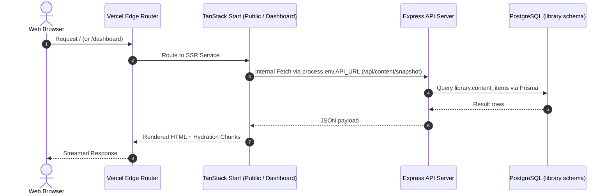

# Architecture Overview

## System Architecture

The platform is structured as a multi-service monorepo orchestrating an Express 5 backend and two TanStack Start SSR frontends:

- **`apps/api/`** — Express 5 + TypeScript backend; Prisma ORM connected to PostgreSQL (`library` schema)
- **`apps/public/`** — Public-facing web application (SSR & SEO optimized), built with TanStack Start, React 19, Tailwind CSS, and Radix UI
- **`apps/dashboard/`** — Editorial management dashboard (authentication, content CRUD, debate archives, media, site settings, user roles)
- **`packages/`** — Shared workspace packages (`api-client`, `shared-types`, `ui`)
- **`vercel.json`** — Vercel multi-service edge routing & deployment configuration

---

## Request Flow



1. **Client Request:** Browser visits the domain and hits Vercel's edge network.
2. **Path Routing:**
   - `/api/(.*)` routes directly to the internal Express `api` service.
   - `/dashboard` & `/dashboard/(.*)` routes to the `dashboard` service.
   - `/(.*)` routes to the `public` site service.
3. **Data Hydration:** The frontends talk to the API server-side using Vercel's injected `API_URL` service binding, and client-side via same-origin requests.
4. **Editorial Operations:** Writes from the dashboard carry the API-issued JWT (`Authorization: Bearer <token>`).
5. **Standardized Responses:** The API validates tokens, enforces role policies, and serves RFC 7807 `application/problem+json` errors on failure.

---

## Authentication & Authorization

- The Express backend serves as its own identity provider: `POST /api/auth/register` and `POST /api/auth/login` issue 7-day HMAC-SHA256 JWTs.
- Public reading is anonymous; editorial operations require authenticated roles (`editor` or `admin`).
- User records and role assignments are stored in `library.users`.
- Admin privilege is granted exclusively through the `AUTH_ADMIN_EMAILS` environment variable (JSON array, e.g. `["admin@moazalian.com"]`).

---

## Frontend Layout

```
apps/public/src/        apps/dashboard/src/
  ├── components/         ├── components/
  ├── routes/             ├── routes/           # Pages + API routes (chat proxy)
  ├── lib/                ├── lib/              # Client helpers & api re-exports
  ├── hooks/              ├── hooks/
  └── test/               └── test/
```

- **Shared Component System:** UI components and primitives live in `packages/ui` for cross-app visual consistency.
- **Unified API Client:** `packages/api-client` provides the single source of truth for backend communication, eliminating duplicate endpoint definitions.

---

## Backend Layout (`apps/api/src/`)

```
apps/api/src/
  ├── domain/         # Enums, ContentItem aggregate, validators (pure business logic)
  ├── services/       # Application layer: content, categories, auth orchestration, caching
  ├── middleware/     # Request tracing, CORS, body binding, rate limiting, JWT auth, RFC 7807 handler
  ├── modules/        # Modular route registration: auth, content, categories, admin, chat, health
  ├── config/         # Environment schema validation (fail-fast with Zod)
  └── lib/            # Prisma instance, cache manager, JWT helpers, password hashing
```

---

## Deployment (Vercel Multi-Service)

`vercel.json` deploys the three active services as an atomic unit:
- `api` (Express 5)
- `public` (TanStack Start)
- `dashboard` (TanStack Start)

Shared workspace packages (`packages/ui`, `packages/api-client`, `packages/shared-types`) are linked across the monorepo during build.
